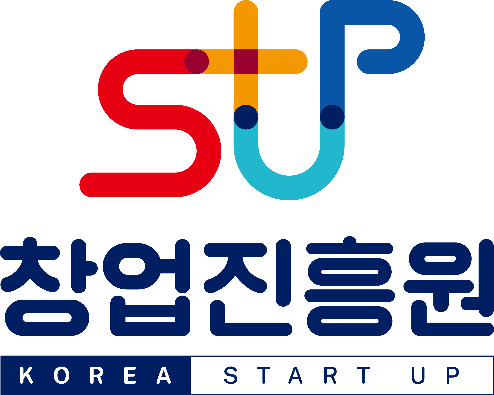

「2026 예비창업패키지 지원사업」
‘창업준비 아카데미(소셜벤처)’프로그램 참여신청서

□ 일반현황

<table>
<tr><th colspan="2">신청자명</th><th colspan="3">000</th><th colspan="2">생년월일</th><th colspan="2"></th></tr>
<tr><td colspan="2">연락처</td><td colspan="3"></td><td colspan="2">이메일</td><td colspan="2"></td></tr>
<tr><td colspan="2">직 업</td><td colspan="7">교수 / 연구원 / 사무직 / 일반인 / 대학생 / 예비창업자 / 취업준비생 등</td></tr>
<tr><td colspan="2">주 소</td><td colspan="7">동까지 기입 가능</td></tr>
<tr><td>사업 분야 (택 1)</td><td colspan="2"></td><td>제조</td><td colspan="2"></td><td>지식서비스</td><td></td><td></td></tr>
<tr><td rowspan="3">기술 분야 (택 1)</td><td colspan="2"></td><td>공예·디자인</td><td colspan="2"></td><td>기계·소재</td><td></td><td>바이오·의료·생명</td></tr>
<tr><td colspan="2"></td><td>에너지·자원</td><td colspan="2"></td><td>전기·전자</td><td></td><td>정보·통신</td></tr>
<tr><td colspan="2"></td><td>화공·섬유</td><td colspan="2"></td><td></td><td></td><td></td></tr>
</table>

□ 신청자 소개 (※ 미작성시 접수과정에서 제외될 수 있음)

<table>
<tr><th>자기소개</th><th><table>
<tr><th>※ 본인의 강점, 경험, 관심분야 등 자유롭게 기재</th></tr>
</table></th></tr>
<tr><td>신청동기</td><td><table>
<tr><th>※ 프로그램에 신청하게 된 동기 작성</th></tr>
</table></td></tr>
<tr><td>창업아이템 (또는 아이디어)</td><td><table>
<tr><th>※ 구상 중인 창업아이템 또는 아이디어를 기재 평소 관심 있는 분야나 해결하고 싶은 문제(없을 경우 생략 가능) - 주요 고객과 해결하려는 문제, 제공할 제품·서비스, 핵심 기능 또는 적용 기술, 기존 제품·서비스와의 차별점, 현재 준비 단계를 중심으로 작성 - 아직 구체화되지 않은 아이디어도 현재 구상한 범위 내에서 작성 가능</th></tr>
</table></td></tr>
<tr><td>향후계획</td><td><table>
<tr><th>※ 본 교육을 통해 얻고 싶은 점, 향후 창업 목표 등 자유롭게 작성</th></tr>
</table></td></tr>
</table>

□ 참가 동의 (※ 동의하지 않을 경우 참가 신청이 완료되지 않음)

| 본 프로그램의 공고문을 면밀하게 검토 및 확인하였으며, 기재된 사항에 대해서 모두 동의합니다. | □ 동의함 □ 동의하지 않음 |
| --- | --- |

2026년 월 일

신청자 : (인)

벤처기업협회장 귀하

공통서류
※ 모든 붙임 목록은 페이지 추가 가능하며,
해당 내용이 식별 가능하도록 스캔 요망
신청자 신분증 사본

<table>
<tr><th>개인정보 수집･이용 동의서 ════════════════════════════════════════════════════════════════════════════════════════ <table>
<tr><th>창업진흥원과 주관기관은「2026년 예비창업패키지 지원사업 벤처기업협회 (창업준비 아카데미) 프로그램」과 관련하여 ｢개인정보보호법」 제15조제1항제3호, 제17조제1항제1호, 제23조제1호, 제24조제1항제1호에 따라 아래와 같이 개인정보의 수집·이용에 관하여 귀하의 동의를 얻고자 합니다.</th></tr>
</table> ◈ 개인정보의 수집․이용에 관한 사항 □ 개인정보의 수집·이용 목적 ◦ 「2026년 예비창업패키지 지원사업 벤처기업협회(창업준비 아카데미) 프로그램」의 운영 관리, 본인 확인절차 및 사업 공고상 결격사유 확인 □ 수집하는 개인정보의 항목 ◦ 성명(영문 포함), 주민(외국인)등록번호, 전화번호(휴대폰, 일반전화), 이메일, 주소 등 * 주민등록번호 처리 근거 법령 : 중소기업창업 지원법 시행령 제41조 □ 개인정보의 보유․이용 기간 ◦ 30년 □ 동의 거부권 및 불이익 ◦ 귀하는 위의 개인정보 수집·이용에 대한 동의를 거부할 권리가 있습니다. 다만, 개인정보 수집 동의를 거부할 경우 「2026년 예비창업패키지 지원사업 벤처기업협회(창업준비 아카데미) 프로그램」 참여에 제한을 받을 수 있음에 유의하시길 바랍니다. □ 위와 같이 귀하의 개인정보를 수집·이용하는 것에 동의합니까? <table>
<tr><th>개인정보</th><th>필수항목 : 개인식별정보</th><th>( □동의함 □동의하지 않음 )</th></tr>
</table> 2026년 월 일 성명 : (인)</th></tr>
</table>

<table>
<tr><th> 개인정보 제3자 제공 동의서 ════════════════════════════════════════════════════════════════════════════════════════ ◈ 제3자 제공에 관한 사항 □ 개인정보를 제공받는 자 ◦ 중소벤처기업부(총괄기관), 창업진흥원(전문기관) □ 개인정보를 제공받는 자의 개인정보 이용 목적 ◦ 「2026년 예비창업패키지 지원사업 벤처기업협회(창업준비 아카데미) 프로그램」의 운영 관리, 및 참여자 정보 관리 등 □ 제공하는 개인정보의 항목 ◦ 성명(영문 포함), 주민(외국인)등록번호, 전화번호(휴대폰, 일반전화), 이메일, 주소 등 * 주민등록번호 처리 근거 법령 : 중소기업창업 지원법 시행령 제41조 □ 개인정보를 제공받는 자의 개인정보 보유 및 이용 기간 ◦ 사업일로부터 5년까지 □ 동의 거부권 및 불이익 ◦ 귀하는 위의 개인정보 수집·이용에 대한 동의를 거부할 권리가 있습니다. 다만, 개인정보 수집 동의를 거부할 경우 「2026년 예비창업패키지 지원사업 벤처기업협회(창업준비 아카데미) 프로그램」 참여에 제한을 받을 수 있음에 유의하시길 바랍니다. □ 위와 같이 귀하의 개인정보를 제3자에게 제공하는 것에 동의합니까? <table>
<tr><th>개인정보</th><th>필수항목 : 개인식별정보</th><th>( □동의함 □동의하지 않음 )</th></tr>
</table> 2026년 월 일 성명 : (인)</th></tr>
</table>