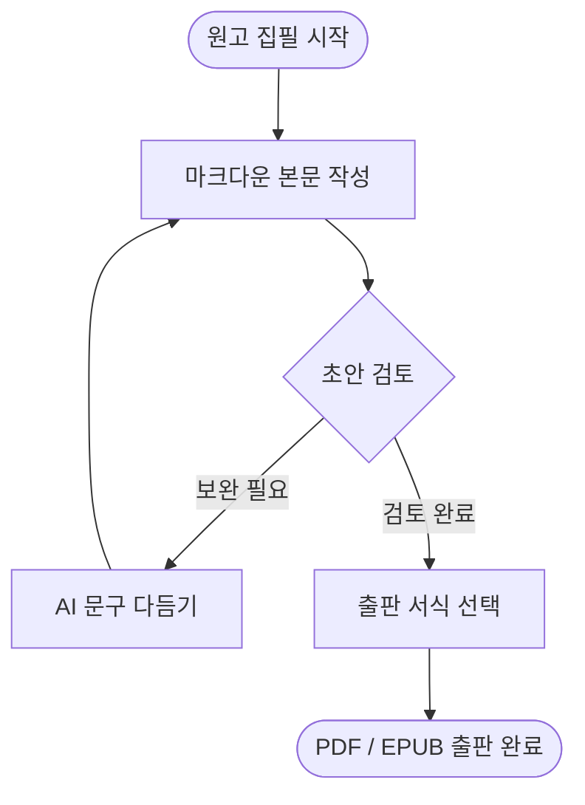

# Mermaid 다이어그램과 도식

온리비 어서는 복잡한 그래픽 툴을 사용하지 않고 오직 텍스트 타이핑만으로 순서도, 시퀀스 다이어그램, 클래스 구조도 등을 그릴 수 있는 **Mermaid 다이어그램 엔진**을 내장하고 있습니다.

---

## 1. 다이어그램 코드 블록 기본 작성법

코드 블록의 언어 식별자에 `mermaid`를 지정하고, 원하는 다이어그램 종류와 노드 연결 관계를 기술합니다:

````markdown

````

- **미리보기 즉시 렌더링**: 원문을 입력하는 즉시 우측 미리보기에 매끄러운 벡터 그래픽 차트가 생성됩니다.
- **인쇄 및 내보내기 완벽 호환**: PDF 인쇄나 DOCX, HWPX로 내보낼 때도 다이어그램이 깨지지 않는 고해상도 그래픽으로 자동 변환되어 포함됩니다.

---

## 2. 지원하는 주요 Mermaid 다이어그램 유형

1. **순서도 (Flowchart - `flowchart TD` / `flowchart LR`)**:
   - 업무 흐름, 논리적 의사결정 트리, 알고리즘을 표현할 때 가장 널리 쓰입니다.
   - `TD`는 상하 방향(Top-Down), `LR`은 좌우 방향(Left-Right)입니다.
2. **시퀀스 다이어그램 (Sequence Diagram - `sequenceDiagram`)**:
   - 시스템 모듈 간 메시지 교환이나 대화형 프로세스의 시간 순서를 표현합니다.
3. **클래스 다이어그램 (Class Diagram - `classDiagram`)**:
   - 소프트웨어 아키텍처나 객체 간의 상속 및 참조 관계를 시각화합니다.
4. **원형 차트 (Pie Chart - `pie`)**:
   - 설문 조사 비율, 예산 배분 등 데이터 점유율을 직관적으로 보여줍니다.

---

## 3. 문법 오류를 방지하는 실전 꿀팁

- **라벨에 괄호나 특수문자가 들어갈 때**:
  - 노드 이름에 괄호나 공백, 대괄호가 포함되면 Mermaid 파서가 문법 기호로 오인할 수 있습니다.
  - 노드 라벨을 반드시 **큰따옴표(`" "`)**로 감싸주세요:
    - *잘못된 예*: `Node[데이터베이스 (SQLite)]`
    - *올바른 예*: `Node["데이터베이스 (SQLite)"]`
- **라벨 내부 HTML 태그 지양**:
  - 라벨 안에 `<br>`, `<b>` 등의 HTML 태그를 직접 넣기보다는 줄바꿈이 필요할 경우 따옴표 안에서 문자열을 구성하는 것이 안전합니다.

---

[도움말 전체 목차](./00_시작하기.md)
