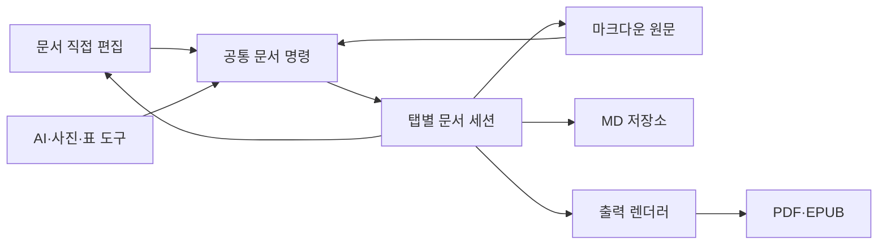

# QA 코드·Mermaid·수식

```text
CODE-BEGIN
    four spaces before this line
GET /api/qa/session?device_uuid=TEST-ONLY-NO-REAL-CREDENTIALS&value=ABCDEFGHIJKLMNOPQRSTUVWXYZ0123456789_ABCDEFGHIJKLMNOPQRSTUVWXYZ0123456789_ABCDEFGHIJKLMNOPQRSTUVWXYZ0123456789_ABCDEFGHIJKLMNOPQRSTUVWXYZ0123456789_ABCDEFGHIJKLMNOPQRSTUVWXYZ0123456789_ABCDEFGHIJKLMNOPQRSTUVWXYZ0123456789_ABCDEFGHIJKLMNOPQRSTUVWXYZ0123456789_ABCDEFGHIJKLMNOPQRSTUVWXYZ0123456789_ABCDEFGHIJKLMNOPQRSTUVWXYZ0123456789_ABCDEFGHIJKLMNOPQRSTUVWXYZ0123456789_ABCDEFGHIJKLMNOPQRSTUVWXYZ0123456789_ABCDEFGHIJKLMNOPQRSTUVWXYZ0123456789_ABCDEFGHIJKLMNOPQRSTUVWXYZ0123456789_ABCDEFGHIJKLMNOPQRSTUVWXYZ0123456789_ABCDEFGHIJKLMNOPQRSTUVWXYZ0123456789_ABCDEFGHIJKLMNOPQRSTUVWXYZ0123456789_ABCDEFGHIJKLMNOPQRSTUVWXYZ0123456789_ABCDEFGHIJKLMNOPQRSTUVWXYZ0123456789_ END-OF-LONG-LINE
CODE-END
```

```javascript
const message = 'QA 한글·English';
console.log(message);
```

CODE-OUTSIDE 다음 본문입니다.

## 정상 Mermaid



## 수식

인라인 수식 $E=mc^2$ 뒤의 본문이 유지되어야 합니다.

$$
\frac{-b \pm \sqrt{b^2-4ac}}{2a}
$$

FORMULA-OUTSIDE 수식 다음 본문입니다.
