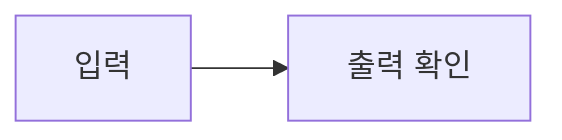

# QA 내보내기

## 텍스트

EXPORT-KOREAN 한글과 English 123이 함께 보입니다. **굵은 글씨**와 ~~취소선~~을 확인합니다.

- 일반 목록 A
- 일반 목록 B

1. 숫자 목록 A
2. 숫자 목록 B

> [!TIP]
> EXPORT-TIP 출력에 보일 안내입니다.

| 품목 | 금액 |
| :--- | ---: |
| EXPORT-TABLE | 12345 |

본문의 각주입니다.[^qa]

[^qa]: EXPORT-FOOTNOTE 각주 내용입니다.

EXPORT-END 마지막 문장이 잘리지 않아야 합니다.
