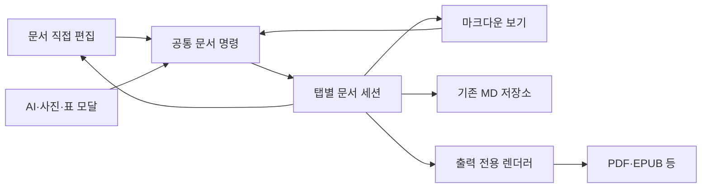

# 온리비 어서 편집 화면 재설계

- 작성일: 2026-10-12
- 상태: 기본 직접 편집 구현 / 그림책 장면 직접 편집 연결 (2026-10-13)
- 기준: 문서 직접 편집을 기본으로 하고 기존 마크다운 편집기를 ‘마크다운 보기’로 제공한다.

## 1. 사용자에게 제공할 화면

| 모드 | 화면 | 사용 목적 |
|---|---|---|
| 편집 — 기본 | 지금의 미리보기처럼 서식이 적용된 문서를 직접 편집 | 글 입력, 제목·목록·표 작성, 사진 삽입 |
| 마크다운 보기 | 기존 Monaco 원문 편집기 | 문법 확인과 원문 수정 |
| 나란히 보기 | 왼쪽 마크다운 원문 / 오른쪽 직접 편집 문서 | 원문과 결과 비교, 고급 작업 |

‘마크다운 보기’에서도 원문 수정은 가능하다. 새 문서는 ‘편집’으로 시작한다. 권한 때문에 읽기만 가능한 문서는 모드와 관계없이 읽기 전용으로 표시한다. 도움말·시작 문서도 읽기 전용 속성으로 구분한다.

### 기본 배치

```text
파일 · 편집 · 삽입 · 서식 · 도움말         저장 · 내보내기
제목/본문 ▼   굵게 · 기울임 · 링크 · 목록 · 표 · 사진
────────────────────────────────────────────────────
탐색기                 문서 직접 편집
폴더와 파일            제목을 클릭해 수정
                       본문 위치를 클릭해 입력
                       사진 위 편집 버튼
────────────────────────────────────────────────────
편집 | 마크다운 보기 | 나란히 보기       저장 상태 · 확대
```

- 문서 영역을 가장 넓게 사용한다. 탐색기는 접을 수 있다.
- 선택 영역 근처의 작은 도구막대에는 자주 쓰는 서식만 제공한다.
- 글꼴·줄간격·여백·용지 같은 문서 전체 설정은 기존 서식설정에 둔다.
- 편집 표시, 블록 선택 테두리, 버튼은 출력 문서에서 제외한다.
- 화면에 두 개의 독립적인 ‘저장’이나 서로 다른 문서 내용을 만들지 않는다.

## 2. 편집 동작

### 일반 문서

1. 새 문서에서 저장 폴더와 이름을 지정한다.
2. 서식이 보이는 문서 영역에 바로 입력하거나 AI가 작성한 글을 붙여넣는다.
3. 도구막대로 제목·목록·표·링크를 넣는다.
4. 사진은 선택한 위치에 저장 후 삽입한다.
5. 자동 저장 상태를 확인하고 PDF·EPUB 등으로 내보낸다.

일반 문서의 편집 화면은 선택한 용지 너비를 사용하되 본문 길이에 따라 세로로 이어진다. 입력할 때마다 인쇄 페이지를 전부 계산하지 않는다. 인쇄 페이지 분할은 내보내기 렌더러가 처리한다. 수동 페이지 나누기 블록은 보존한다.

### 그림책

- 기존 `:::scene` 한 개가 한 페이지다. 자동 이어쓰기는 사용하지 않는다.
- 왼쪽에 장면 목록을 선택적으로 표시한다. 장면을 선택하면 해당 페이지로 이동한다.
- 글 영역을 클릭해 제목과 본문을 직접 고친다.
- 그림 영역에 마우스를 올리면 ‘편집’ 버튼이 나타난다. 버튼으로 사진 모달을 연다.
- 페이지 추가·복제·이동·삭제는 장면 단위 명령이다.
- 입력 중 글이 넘치면 해당 페이지에 안내한다. 표시하지 못한 글을 삭제하거나 잘라 저장하지 않는다.
- 넘친 글도 편집할 수 있도록 글 영역의 편집 상태에서는 내부 스크롤을 제공한다. 출력 상태에서는 넘침을 검사하고 안내한다.
- 일반 문서와 같은 편집 모델 안에서 장면별 본문 범위를 편집한다. 페이지마다 독립적인 대형 편집 엔진을 여러 개 실행하지 않는다.

## 3. 저장 형식과 원문 보존

저장 파일은 기존 `.md`를 유지한다. HTML이나 편집 엔진 JSON을 새로운 기본 저장 형식으로 바꾸지 않는다.

```markdown
---
메타영역
#서식설정
css_profile: profile-book-example
css_profile_name: "그림책 서식"
---

:::scene


## 제목

본문입니다.
:::
```

- 메타데이터는 문서 설정 화면에서 관리한다. 본문 직접 편집 영역에는 노출하지 않는다.
- 사용자 서식은 기존 리소스 폴더의 `profiles/userCssProfiles.json`에서 ID로 찾는다.
- 이미지·첨부자료는 기존 로컬/개인 Google Drive 리소스 경로를 유지한다.
- 이미지 Base64는 MD 본문에 저장하지 않는다.
- 문서를 열고 닫거나 보기 모드만 바꿨을 때는 파일 내용을 변경하지 않는다.
- 수정하지 않은 블록은 원래 MD 문자열, 공백, 이미지 참조 정의, 코드 펜스 등을 유지한다.
- 편집한 블록만 직렬화한다. 구조 변경 시에도 변경 범위에 포함된 블록만 다시 작성한다.
- 인식하지 못하는 문법은 원문을 보존하는 블록으로 유지한다. 변환하기 어려운 내용이 있다는 이유로 제거하지 않는다.

## 4. 공통 문서 상태

현재 `content`, Monaco 모델, 탭의 `content`를 여러 경로에서 갱신한다. 재설계에서는 탭마다 하나의 문서 세션이 변경과 저장을 관리한다.



### 세션의 책임

| 항목 | 규칙 |
|---|---|
| 문서 식별 | 문서 ID와 변경 버전을 가진다 |
| 저장 원본 | 정본은 MD 문자열이며 편집용 문서 트리는 파생 상태다 |
| 변경 명령 | 입력·서식·모달 삽입 모두 같은 명령 경로를 사용한다 |
| 실행 취소 | 한글 조합과 연속 입력을 묶고 모드 전환 후에도 이력을 유지한다 |
| 선택 위치 | 원문 줄 번호에만 의존하지 않고 블록 ID와 블록 내 위치를 관리한다 |
| 저장 상태 | 변경됨·저장 중·저장됨·저장 실패를 공통 표시한다 |
| 비동기 적용 | 모달을 연 문서와 버전, 선택 대상이 달라지면 잘못된 위치에 적용하지 않는다 |

직접 편집 중에는 편집 트리의 변경 범위를 MD 패치로 변환한다. 한글 조합 중에는 모델 교체나 재파싱을 하지 않는다. 마크다운 보기에서 수정할 때는 해당 영역을 다시 파싱한다. 두 화면을 동시에 보더라도 실제 입력 소유자는 포커스를 가진 화면 한 곳이다.

저장·모드 전환·문서 전환·내보내기 전에는 미반영 입력을 완료하고 직렬화한다. 입력 중인 값과 다른 오래된 MD를 자동 저장하지 않는다.

## 5. 편집 엔진과 문서 블록

단순히 기존 ReactMarkdown 출력 DOM 전체에 `contentEditable`을 붙이고 `innerHTML`을 다시 MD로 바꾸는 구조는 채택하지 않는다. 한글 입력, 선택, 실행 취소, 표와 사용자 문법 보존을 편집 엔진과 변환 계층에서 관리한다.

편집 엔진은 ProseMirror 계열을 우선 검토한다. 사용자 문서 스키마와 별도 모델·상태·뷰를 제공하는 특성이 온리비의 사용자 문법 연결에 적합하다는 설계 판단이다. 현재 저장소에는 해당 의존성이 없으므로 설치 전에 작은 검증 문서로 입력·변환·성능을 확인한다. 엔진의 기본 Markdown 변환기로 기존 문서 전체를 재작성하지 않는다.

공식 근거: [문서 모델과 사용자 스키마](https://github.com/ProseMirror/prosemirror-model), [편집 상태](https://github.com/ProseMirror/prosemirror-state), [뷰](https://github.com/ProseMirror/prosemirror-view). 공식 저장소 안내상 소스 호스팅이 이전됐으므로 실제 도입 시 현재 배포와 새 저장소의 변경 기록을 확인한다. [기존 공식 MIT 라이선스](https://github.com/ProseMirror/prosemirror/blob/master/LICENSE).

### 블록별 처리

| 내용 | 직접 편집 | 원문 보존 |
|---|---|---|
| 제목·문단·굵게·기울임·취소선·링크 | 본문/도구막대에서 수정 | 수정한 범위만 MD 변환 |
| 목록·체크리스트·인용문 | 항목 입력과 체크, 인용 서식 적용 | 목록 구조와 체크 상태 보존 |
| 이미지 | 사진 모달·드래그·붙여넣기 | 기존 경로·참조 정의·크기·정렬 유지 |
| 일반 표 | 셀 편집, 행·열 명령 | 표 헤더·정렬 보존 |
| 확장 표·셀 병합 | 전용 표 편집이 준비되기 전까지 블록으로 표시하고 원문 수정 제공 | 지원하지 않는 구조를 일반 표로 덮어쓰지 않음 |
| 코드·Mermaid·수식 | 결과를 표시하고 ‘편집’으로 원문 입력 | 코드 종류, 수식 구분자, 메타정보 보존 |
| 각주·인용·참고문헌 | 전용 입력과 링크 연결 | 식별자와 문헌 파일 참조 보존 |
| 콜아웃·동영상·지도·문서 링크 | 기존 모달과 전용 블록 연결 | 온리비 문법 보존 |
| 그림책 | 장면 안의 제목·본문·그림 수정 | `:::scene` 경계와 표지 속성 보존 |
| 사용자 HTML·미지원 문법 | 결과 카드와 원문 편집 제공 | 원래 문자열을 그대로 유지 |

## 6. 공통 명령과 기존 기능 연결

새 명령 계층은 다음 기능을 제공한다.

```text
insertText / replaceSelection / setHeading / toggleMark
insertList / insertTable / editCodeBlock
insertImage / replaceImage / insertMedia / insertDocumentLink
insertScene / moveScene / removeScene
undo / redo / find / replace / flushInput
```

기존 도구막대·단축키·AI 모달은 `editorRef.executeEdits`를 직접 호출하지 않고 현재 문서 세션과 명령 어댑터를 사용한다. Monaco는 마크다운 모드용 어댑터가 된다. AI 적용 전후 비교도 이 공통 변경 기록을 사용한다.

### 붙여넣기

- 텍스트·HTML·이미지·파일을 하나의 공통 처리기로 분류한다.
- 일반 붙여넣기는 제목·문단·목록·링크 등 지원되는 의미 구조를 가져온다.
- ‘텍스트만 붙여넣기’도 제공한다.
- 클립보드에 들어온 내용이 실제 Markdown 코드라면 명시적으로 ‘마크다운으로 붙여넣기’ 명령을 제공한다. 일반 문장의 기호를 임의로 문법으로 바꾸지 않는다.
- 이미지는 기존 리소스 저장 서비스를 거쳐 참조 경로를 삽입한다. 저장 중 표시와 실패 메시지를 제공한다.
- 동일 이벤트 중복만 막는다. 같은 이미지를 다시 붙여넣는 정상 작업은 허용한다.
- 모달의 입력은 본문 편집기의 전역 이벤트가 가로채지 않도록 한다.

## 7. 서식과 내보내기

문서 내용과 문서 서식은 분리한다. 제목·문단 등 의미 구조는 MD에 저장하고 글꼴·용지·여백 같은 표현은 기존 서식 파일에서 읽는다.

편집 엔진의 본문 DOM과 출력 렌더러가 같은 서식 규칙을 사용하도록 어댑터를 만든다. 편집기의 도구막대와 선택 표시에는 본문 CSS가 적용되지 않도록 범위를 제한한다.

내보내기는 편집 DOM을 직접 복사하는 대신, 확정된 MD 버전으로 만든 출력 전용 렌더링을 사용한다. 폰트·이미지 준비 후 결과를 만든다. 커서·선택·편집 버튼·대화상자는 출력에서 제외한다.

- 일반 문서: 기존 PDF·EPUB·HTML·DOCX·HWPX·PNG 경로 유지.
- 그림책: DOCX·HWPX 제한 유지, PDF와 고정 배치 EPUB 사용.
- 그림책 넘침 경고 유지, 자동 이어쓰기 제외.
- 로컬·Google Drive 저장 위치 선택과 자료 복사 기능 유지.

## 8. 성능 기준

- 입력마다 전체 Markdown을 재파싱하거나 전체 페이지를 복제·측정하지 않는다.
- 한글 조합 중 React 렌더링으로 편집 DOM을 교체하지 않는다.
- 수정한 블록과 인접 구조만 갱신한다.
- 이미지 로딩·스크롤·문서 변경을 서로 다른 갱신 경로로 처리한다.
- 탭 이동 후 이전 비동기 작업이 새 문서를 수정하지 않도록 취소·버전 확인을 적용한다.
- 편집/원문 전환 시 기존 이미지를 전부 다시 내려받지 않도록 캐시와 리소스 식별자를 공유한다.
- 큰 그림책은 현재 장면과 주변 장면 중심으로 편집 뷰를 유지한다. 출력 준비 때 전체 문서를 렌더링한다.
- 실제 문서와 50장면 그림책으로 한글 입력 지연, 모드 전환, 이미지 재요청 횟수를 측정한다. 매 입력 때 50페이지 전체를 갱신하면 도입 기준을 통과하지 못한 것으로 본다.

## 9. 구현 순서와 완료 기준

| 단계 | 작업 | 다음 단계로 넘어가는 기준 |
|---|---|---|
| 1. 호환성 검증 | MD 블록 모델·변환·선택 매핑, 엔진 작은 시제품 | 기존 문서를 열고 저장만 했을 때 원문 동일. 미지원 블록 보존 |
| 2. 공통 상태 | 문서 세션·명령·실행 취소·저장 연결 | 두 모드에서 수정한 내용이 같은 파일에 저장. 탭 간 혼입 없음 |
| 3. 기본 직접 편집 | 제목·본문·기본 서식·목록·링크·사진 | 한글 조합, 붙여넣기, 실행 취소, 자동 저장 검증 |
| 4. 그림책 | 장면별 직접 편집·사진 모달·수동 페이지 관리 | 선택한 장면만 변경. 성능 및 넘침 경고 검증 |
| 5. 복합 문서 | 표·수식·코드·Mermaid·각주·콜아웃 | 실제 기존 원고의 구조·원문·리소스 보존 |
| 6. 기본 모드 전환 | 명칭·저장된 설정·도움말·도구막대·권한 갱신 | 데스크톱/웹에서 같은 작업 흐름. 읽기 전용 권한 유지 |

작업은 단계적으로 구현하되 최종 기본 화면은 사용자 요청대로 ‘편집’이다. 복합 문법이 준비되기 전에는 그 블록의 원문 편집을 제공한다. 기본 입력을 완료했다는 이유로 표·그림책·미지원 문법을 변환 과정에서 잃게 하지 않는다.

### 필수 검증

- 한글 조합 중 Enter·Backspace·방향키, 긴 문단과 인라인 서식.
- 원문 보기 ↔ 직접 편집 ↔ 나란히 보기 전환 후 선택 위치와 실행 취소.
- 새 문서, 기존 파일, 탭 전환, 저장 실패, 로컬/Google Drive 저장.
- 이미지 복사·드래그·사진 모달, 반복 붙여넣기, 실패 후 재시도.
- 일반 표와 확장 표, 수식, Mermaid, 각주, 문헌 참조, 사용자 HTML.
- 그림책 장면 추가·수정·삭제·이동 및 넘침. 내보내기에서 편집 UI 제외.
- 사용권한 만료 및 도움말 문서의 읽기 전용 유지.
- 실제 PDF·EPUB 결과와 직접 편집 화면 비교.

## 10. 코드 변경 범위

| 현재 파일 | 변경 방향 |
|---|---|
| `MainEditorApp.tsx` | 화면 배치와 세션 연결 중심으로 축소, 새 모드 구분 |
| `useEditorTabs.ts` | 탭별 문서 세션, 공통 변경·저장 상태 |
| `useEditorHandlers.ts` | 현재 편집기 종류와 무관한 명령 사용 |
| `useMonacoSetup.ts` | 마크다운 보기 전용 입력·선택 어댑터 |
| `MarkdownViewer.tsx` | 출력/읽기 전용 렌더러 역할 정리 |
| `PicturebookPreview.tsx` | 장면 틀과 글 직접 편집 영역 연결 |
| `StatusBar.tsx`, 메뉴·설정 | 편집·마크다운 보기·나란히 보기 명칭과 상태 |
| `ModalManager.tsx` | 문서·선택 대상에 연결된 모달 적용 명령 |
| `exportHandlers.ts` | 확정된 문서 버전의 출력 DOM 사용 |

새로 분리할 모듈: `DocumentSession`, `EditorCommands`, `VisualDocumentEditor`, `MarkdownSourceEditor`, `DocumentCodec`, `SourceMap`, `PicturebookEditor`, `ExportDocumentRenderer`.

기존에 저장된 `edit`/`preview`/`both` 설정은 버전이 있는 환경설정 마이그레이션으로 새 모드에 대응시킨다. 첫 전환은 ‘편집’을 기본으로 하고, 이후에는 사용자가 마지막으로 선택한 모드를 유지한다. 기존 `preview`의 편집 차단 가드를 그대로 새 편집 화면에 사용하지 않는다. 읽기 전용 여부는 별도 권한 상태로 판정한다.

## 11. 2026-10-13 진행 기록

- 사용자 확인에 따라 데스크톱 반영과 일반 문서 핵심 동작 점검은 완료로 취급한다.
- 다음 단계로 그림책의 장면 본문 직접 편집을 연결했다. 페이지의 ‘본문 편집’으로 시작하고 ‘편집 완료’로 조판 화면으로 돌아간다.
- 한 번에 한 장면만 ProseMirror 편집기를 실행한다. 제목·본문·기본 서식은 기존 직접 편집기를 재사용한다.
- 장면 추가·복제·위/아래 이동·삭제 제공. 표지는 첫 위치에 유지하고 표지 복제는 일반 장면으로 만든다.
- 본문만 수정하며 첫 그림 참조, 다른 장면 원문, 장면 밖 참조 정의는 보존한다. 편집 대상이 변경되면 적용을 차단한다.
- 입력 영역에는 내부 스크롤을 제공하며 자동 이어쓰기는 사용하지 않는다. 출력/권한 제한 시 직접 편집을 제공하지 않는다.
- 검증: 타입 검사, 관련 ESLint, 그림책 본문 변경·참조 보존·복제·오래된 대상 차단 테스트 통과.
- 남은 단계: 그림책 편집기의 공통 우측 명령·이모지 연결, 복합 블록 전용 편집, 공통 세션 및 모드/권한 전체 정리. 이번 구현만으로 전체 개편을 완료로 표시하지 않는다.
